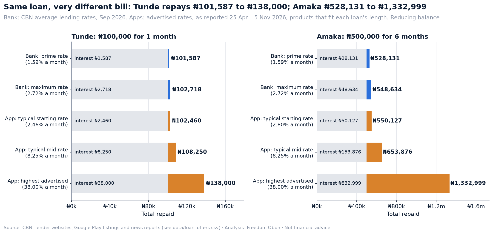
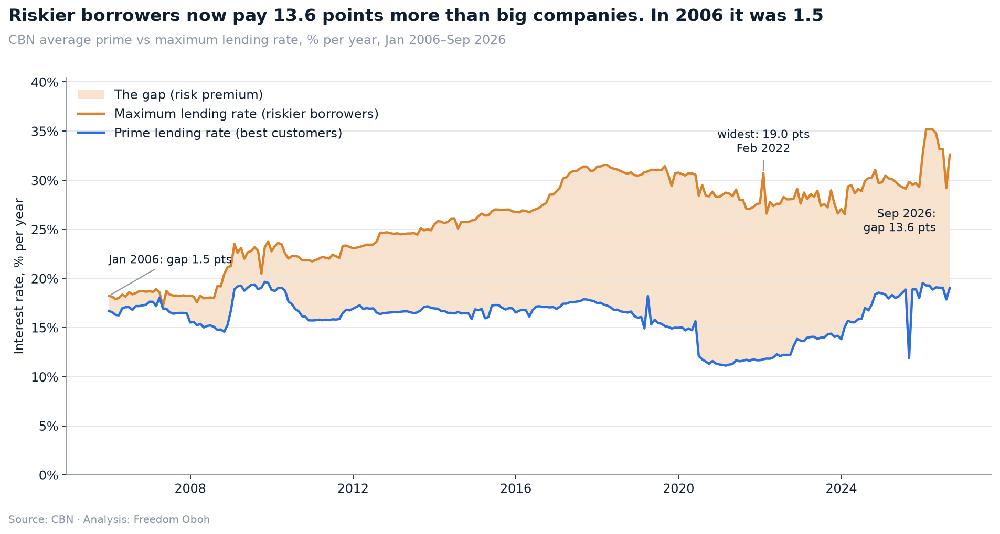
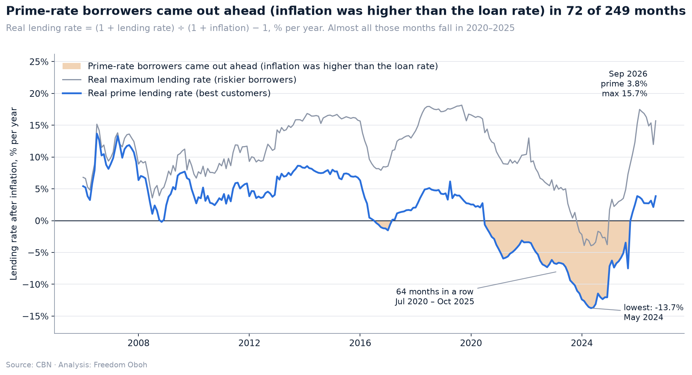
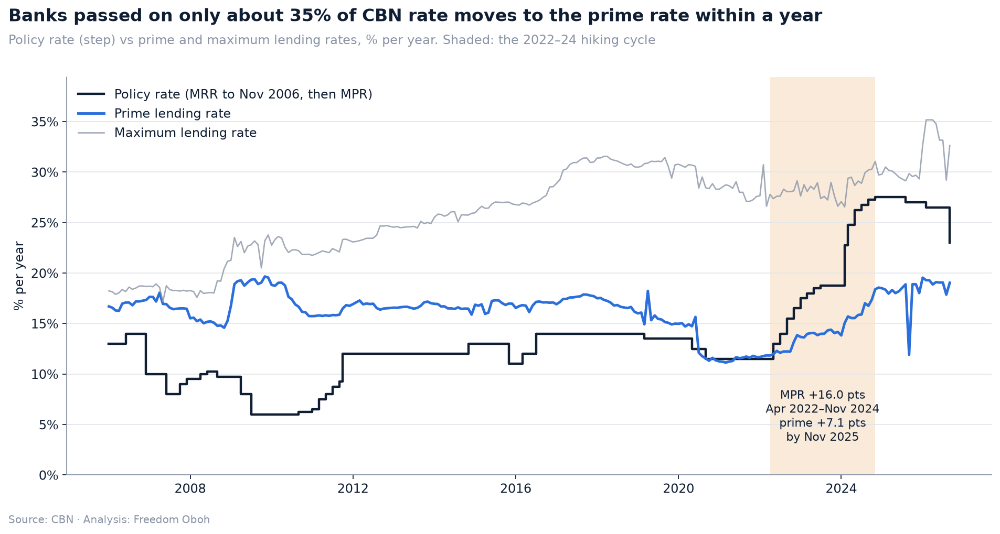
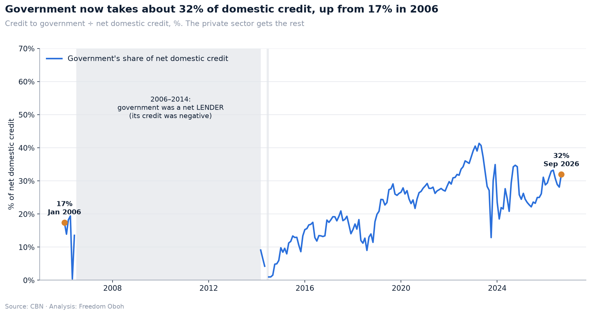
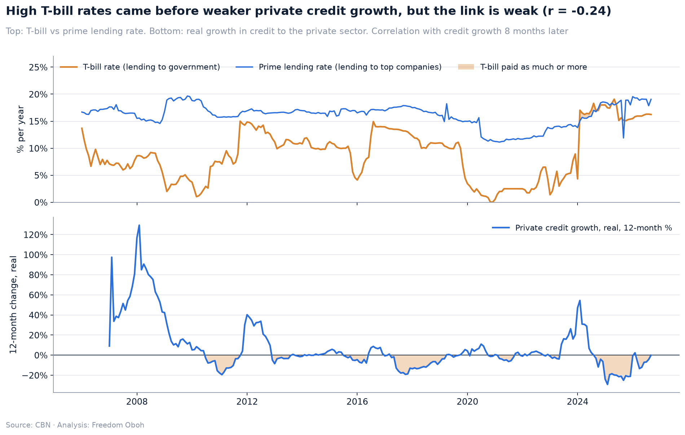
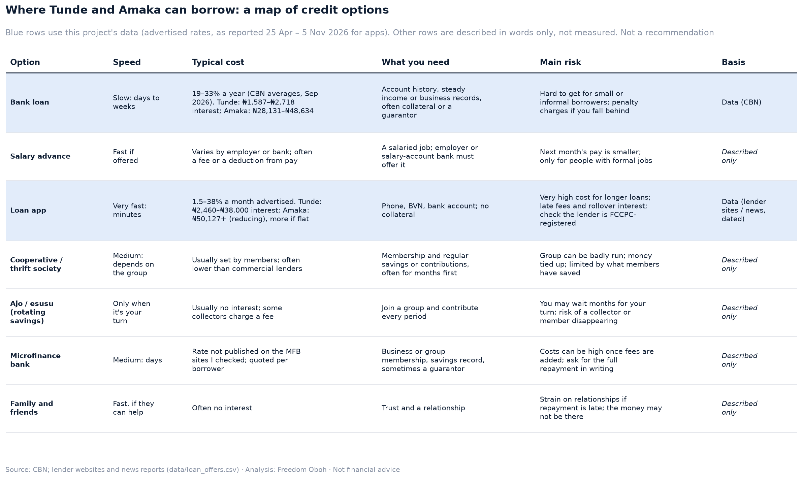
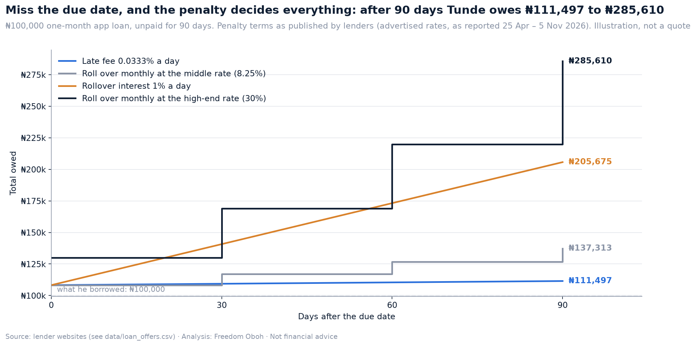
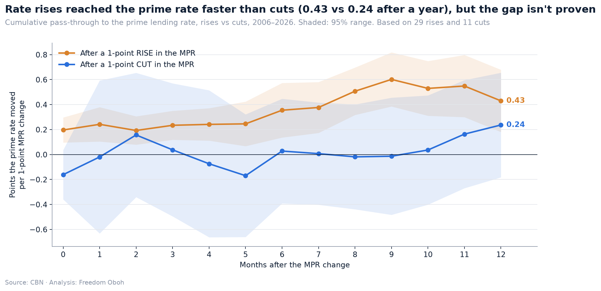
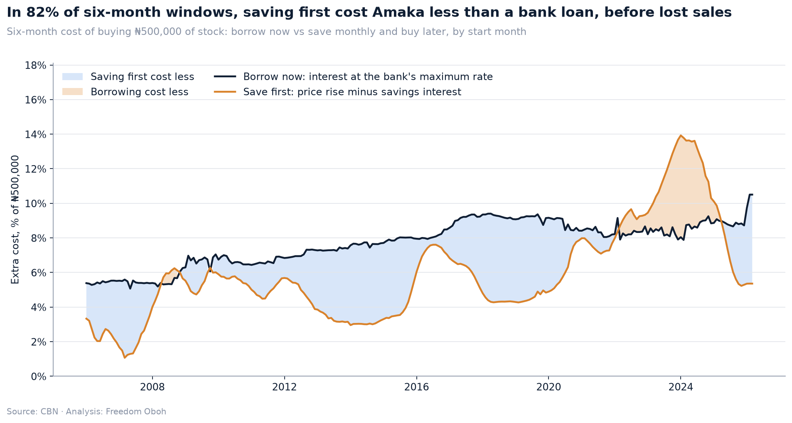

# Who Gets to Borrow in Nigeria?

**Banks, loan apps and the common man: a Python data analysis of the price of credit in Nigeria and who gets it (CBN data, Jan 2006 – Sep 2026).**

> ⚠️ **Not financial advice.** This is a historical data analysis and a learning project. It does not recommend any bank, loan app or lender.

## 🧮 Try the calculator: [naija-loan-cost.streamlit.app](https://naija-loan-cost.streamlit.app/)

**What will this loan really cost me?** Type in any loan and see what it costs per year, the total you'll repay in naira, a month-by-month breakdown, how it compares with bank and loan app rates, and what happens if you pay late. It works on your phone, it's free, and it stores nothing. To run it on your own computer, see [How to run it](#how-to-run-it-windows).

---

## Why this question matters

I once worked as a credit risk analyst. My day-to-day was assessing loans for SMEs, individuals and corporations, and I saw a lot of bias in who got approved. I also know many people who took quick loans, and when they defaulted the interest grew so fast that paying back became impossible.

In my last project, [savings vs inflation](https://github.com/Freedom15dev/nigeria-savings-vs-inflation), I showed that money left in a Nigerian savings account since 2006 lost most of its value. Saving lost. So this project asks the other side of the question:

> **If saving loses money in Nigeria, what does it cost to borrow? And who actually gets to borrow at all?**

To make it real, I follow two people. For this case study, let's call them **Tunde** and **Amaka**. They are illustrations, not real people:

- **Tunde**, a salary earner in Lagos. His generator packs up and he needs **₦100,000 for one month**.
- **Amaka**, who runs a provisions shop (an SME). She needs **₦500,000 for six months** to restock before the festive season.

---

## The short answer



| Where they borrow | Tunde: rate a month | Tunde repays (₦100,000, 1 month) | Amaka: rate a month | Amaka repays (₦500,000, 6 months) |
|---|---|---|---|---|
| Bank, prime rate | 1.59% | ₦101,587 | 1.59% | ₦528,131 |
| Bank, maximum rate | 2.72% | ₦102,718 | 2.72% | ₦548,634 |
| Loan app, typical starting rate | 2.46% | ₦102,460 | 2.8% | ₦550,127 |
| Loan app, typical mid rate | 8.25% | ₦108,250 | 8.25% | ₦653,876 |
| Loan app, highest advertised | 38% | ₦138,000 | 38% | ₦1,332,999 |

*How the app rows are worked out: **typical starting rate** = the median of the advertised minimum rates; **typical mid rate** = the median of the mid-points of each advertised range; **highest advertised** = the highest advertised maximum. Each person's figures use only app products whose advertised tenor covers their loan (no payroll loans, and no business loans for Tunde). Bank: CBN average lending rates, Sep 2026. Apps: advertised rates, as reported 25 Apr – 5 Nov 2026 ([data/loan_offers.csv](data/loan_offers.csv)). Reducing balance for all, which is the kindest assumption for the apps.*

**In plain words:**
- **The cheaper the credit, the harder it is to get.** The bank is cheapest on paper, but slow and hard to qualify for. The loan app is fast and open to almost anyone, and it is priced by the month.
- **A good app offer can cost about the same as a bank loan at the maximum rate: a typical starting app rate of 2.46% a month for Tunde and 2.80% for Amaka, against 2.72% at the bank. The real danger is the highest advertised rates and what happens after the due date.**
- **The cheapest advertised apps (Airmoni and LetsGo) don't offer a one-month loan**, so the lowest rates aren't open to someone in Tunde's position.
- **A risky borrower now pays 13.6 points more than a big company** at the bank. In 2006 the gap was 1.5.
- **Government takes about 31.9% of domestic credit**, up from 17.4% in Jan 2006. In real naira, credit to businesses and households is back to its 2008 level.
- **The danger is after the due date.** With rollover interest of 1% a day (simple interest on the amount due, not compounded), Tunde's ₦100,000 becomes **₦205,675 in 90 days**.

---

## The story behind the answer

### 1. The price tag at the bank: prime vs maximum lending rate



The **prime lending rate** is what banks charge their best customers, usually big companies. The **maximum lending rate** is what riskier borrowers face. The gap between them is the **risk premium**.

In Sep 2026, prime was **19.04%** and the maximum was **32.62%**. Since Jan 2006, prime went from 16.69% to 19.04%, while the maximum went from 18.23% to 32.62%. Big companies borrow near the prime rate. Amaka pays closer to the maximum rate, if she gets a loan at all.

### 2. Real interest rates: is borrowing cheap once you remove inflation?



The **real rate** is the interest rate after inflation, from the Fisher equation: (1 + loan rate) ÷ (1 + inflation) − 1.

- At the prime rate, **borrowers came out ahead (inflation was higher than the loan rate) in 72 of 249 months**, and 64 of those came in a row (Jul 2020 – Oct 2025). In those months, big borrowers repaid less, in real terms, than they borrowed.
- At the **maximum** rate, borrowers came out ahead (inflation was higher than the loan rate) in only **14 months**.
- **Savers lost to inflation in 249 months**, every month in the data. The bank's margin sits between them: the prime rate averaged 12.6 points above the savings rate. When savers lose, borrowers don't automatically win.
- Today, with inflation at 14.63%, a small borrower near the maximum rate pays about **15.7% a year above inflation**.

### 3. MPR pass-through: does the CBN's rate reach the street?



The **MPR (Monetary Policy Rate)** is the CBN's main interest rate. The CBN raised it by **16 points** (Apr 2022 – Nov 2024). Twelve months after the last rise, the prime rate was up **7.1 points** (44% of the rise) and the maximum rate only **1.9 points**.

Across 20 years, a regression with 0–12 monthly lags finds banks passed on about **0.35 points of every 1-point MPR change** to the prime rate within a year (95% range 0.12 to 0.58), with half of that arriving within about **6 months**. For the maximum rate, the link (0.2) is too weak to measure with confidence.

### 4. Credit to government vs credit to the private sector



Government's share of net domestic credit is now **31.9%**, against 17.4% in Jan 2006. From Jul 2006 to Jun 2014, government credit was *negative* in 93 months: government held more deposits in the banks than it borrowed, so on net it was a lender.

In nominal terms, credit to the private sector grew 42× (₦1.98tn → ₦83.93tn). Prices rose 15.5×. **In real naira, private credit is back to its Apr 2008 level.**

### 5. Crowding out: Treasury bills vs lending to small businesses



A **Treasury bill (T-bill)** is a short loan to the Federal Government, about the safest thing a bank can buy. On average, lending at the prime rate paid a bank 7.2 points more than a T-bill. But in **11 months of 2024–25, the T-bill paid as much or more**. In Sep 2026 the gap was 2.8 points (16.24% vs 19.04%).

When government borrows a lot and pays well for it, banks have less reason to lend to businesses. Economists call this **crowding out**. In the data, high T-bill rates came before weaker real private credit growth about 8 months later (r = -0.24), but that link explains only about 6% of the ups and downs. **Correlation is not proof.**

### 6. Loan apps in Nigeria: what does the fast option cost?

Digital lenders (FairMoney, Carbon, Branch, Renmoney and others) need no collateral and can pay out in minutes, but they price **per month**. Advertised rates in this project's data run from **1.5% to 38% a month**. Tunde's typical mid rate, 8.25% a month, is about **159% a year** compounded.

A good app offer can cost about the same as a bank loan at the maximum rate: a typical starting app rate of 2.46% a month for Tunde and 2.80% for Amaka, against 2.72% at the bank. The real danger is the highest advertised rates and what happens after the due date.

**Flat vs reducing balance:** many apps charge interest on the full amount for every month. At Amaka's typical mid rate, flat interest would raise her bill from ₦653,876 to **₦747,500** (61% more interest).

**Why apps charge more:** no collateral, high default risk, a higher cost of money, and fixed costs spread over small, short loans.

**Regulation:** the FCCPC's *Digital, Electronic, Online, or Non-Traditional Consumer Lending Regulations, 2025* require registration, plain disclosure of rates and fees, and confirmation that apps won't access contacts or photos, with fines of up to ₦100 million. They set **no interest rate cap**.

### 7. Where does the common man go? A map of credit options



Bank loan, salary advance, loan app, cooperative, ajo / esusu, microfinance bank, family and friends. Only the bank and loan app rows carry numbers from this project. The others are described in words.

### 8. What happens when Tunde misses the due date?



On the due date Tunde owes ₦108,250. If he can't pay for 90 days, the penalty terms decide everything: from **₦111,497** (a small daily late fee) to **₦205,675** (rollover interest of 1% a day, 2.1× what he borrowed) and **₦362,674** (rolling over monthly at the highest advertised rate, 38% a month). The 1% a day is treated as simple interest on the amount due, not compounded, which is the kinder assumption. This is the pattern I saw in real life.

### 9. Do banks pass on rate cuts as fast as rate rises?



Six months after a 1-point MPR **rise**, the prime rate had moved **0.35** points. After a **cut**, only **0.03**. After a year: 0.43 vs 0.24. That looks like "up the stairs, down the slope", but with only 11 cuts in 20 years, the gap is **not statistically proven**.

### 10. Save first, or borrow now?



In **82%** of six-month windows (199 of 243), saving monthly and buying later cost Amaka less in naira than a bank loan at the maximum rate. The exceptions were loans starting in 2022–2024, when prices rose faster than loan interest. This leaves out the biggest cost of waiting, **lost festive-season sales**, which this data can't measure.

---

## What I learned

1. **The price of a bank loan depends more on who you are than on what the CBN does.** About 35% of a CBN rate move reaches the prime rate in a year, while the gap between best and worst bank rates grew from 1.5 to 13.6 points.
2. **Savers lost every month. Borrowers didn't come out ahead every month.** Savers lost to inflation in 249 months, all of them. Prime-rate borrowers came out ahead (inflation was higher than the loan rate) in only 72 months.
3. **Government moved up the queue.** Its share of domestic credit went from 17.4% to 31.9%, and T-bills sometimes paid banks as much as their best customers.
4. **Fast money is priced by the month, and that hides how expensive it is**, especially after the due date.
5. **The cheaper the credit, the harder it is to get.**

## What to watch

- **MPR decisions.** On 22 Sep 2026 the CBN cut the MPR by 350 basis points to 23%, the biggest cut since 2006 ([Nairametrics, 22 Sep 2026](https://nairametrics.com/2026/09/22/cbn-resets-mpr-by-350-basis-points-to-23-biggest-cut-since-2006/)). The Sep 2026 prime rate (19.04%) mostly reflects the period before the cut. Chapters 3 and 9 suggest only part of a cut reaches borrowers, and slowly.
- **Inflation.** When inflation falls faster than lending rates, real borrowing costs rise.
- **T-bill rates.** The closer they sit to the prime rate, the less reason banks have to lend to small businesses.
- **Credit to the private sector, in real terms.** Nominal growth can hide a real fall.
- **FCCPC enforcement.** Whether loan apps publish their rates as the 2025 regulations require.

**The practical takeaway is general: turn any monthly rate into a yearly one, ask whether interest is flat or reducing, and read what happens after the due date, before you compare.**

---

## Limitations (please read)

- **CBN lending rates are averages** reported by banks, not a quote any borrower would get.
- **Loan app rates are advertised rates.** Airmoni, Branch, Carbon, FairMoney, LetsGo were checked on the lenders' own pages or Google Play listings on 5 Nov 2026 (6 of 10 products). The rest (EaseMoni, Okash, QuickCheck, Renmoney; 4 products) come from news reports (Legit.ng, Nairametrics). Actual offers depend on the borrower. Products whose tenor isn't published are kept in both Tunde's and Amaka's figures. Palmcredit, Aella, Specta and Lidya were left out because no rate could be sourced. Okash and EaseMoni appear only in the FCCPC's table of CBN-licensed lenders, not its main approvals table.
- **No microfinance bank rates.** The MFB websites I could reach didn't publish a rate, so microfinance is described in words only.
- **Real values use an approximate price index**, chained from CBN year-on-year inflation, which includes the NBS 2025 revision and the January 2025 CPI rebasing. The June 2025 inflation figure duplicates May in the CBN feed and is interpolated.
- **Data gaps.** The T-bill rate shows 0.00 in Dec 2017, Dec 2018 (treated as missing). The money and credit data has no record for Mar 2026. Gaps are filled only for charts, never for statistics. Some single months in the credit data jump sharply and are reported as they are.
- **Pass-through and crowding-out results are averages with low explanatory power** (R² = 0.02 for the prime rate). Correlation is not proof of cause.
- **The analysis uses data up to September 2026.**

---

## Methods at a glance

| Chapter | Question | Method |
|---|---|---|
| 1 | Bank lending rates | Prime vs maximum lending rate; the risk-premium gap |
| 2 | Real interest rates | Fisher equation with CBN inflation |
| 3 | MPR pass-through | Cross-correlation (lags 0–12); distributed-lag OLS with Newey–West errors (`statsmodels`) |
| 4 | Who gets the credit | Credit to government vs private sector, real naira |
| 5 | Crowding out | T-bill vs prime spread; lagged correlation with real private credit growth |
| 6 | Loan apps vs banks | Monthly → simple and effective annual rates; reducing vs flat repayment (`src/loan_math.py`) |
| 7 | Credit options map | Table of options; data rows vs described rows |
| 8 | Default debt spiral | Published late-fee and rollover terms over 90 days |
| 9 | Hikes vs cuts | Asymmetric distributed-lag regression |
| 10 | Save vs borrow | Rolling six-month comparison with the price index |

Every chapter opens with a plain-words question and ends with an **"Under the hood"** note.

---

## Data sources

| Source | What |
|---|---|
| [CBN money market indicators](https://www.cbn.gov.ng/api/GetAllMoneyMarketIndicators) | Monthly MPR, MRR, T-bill, deposit, prime and maximum lending rates |
| [CBN money and credit statistics](https://www.cbn.gov.ng/api/GetAllMoneyAndCreditStats) | Credit to government, credit to private sector, net domestic credit (₦ millions, nominal) |
| [CBN inflation rates](https://www.cbn.gov.ng/api/GetAllInflationRates) | Headline year-on-year inflation |
| [data/loan_offers.csv](data/loan_offers.csv) | Hand-collected loan app rates, each with a source URL and date |
| [FCCPC approved digital lenders](https://fccpc.gov.ng/approvals-of-dmls/) | Register checked 5 Nov 2026 |
| [FCCPC Digital Lending Regulations, 2025](https://fccpc.gov.ng/wp-content/uploads/2025/08/DIGITAL-CONSUMER-LENDING-2025-LATEST.pdf) | Registration, disclosure, penalties; no rate cap |

**Context figures (cited, not modelled):**
- Private sector credit about 17% of GDP in 2025; SMEs get about 1% of bank credit; about 55% of credit is under one year: CPPE policy brief, via [Nairametrics, 29 Mar 2026](https://nairametrics.com/2026/03/29/cppe-flags-weak-credit-allocation-despite-bank-recapitalisation-in-nigeria/).
- "Fewer than one in twenty MSMEs have access to bank credit": [World Bank press release, 22 Dec 2025](https://www.worldbank.org/en/news/press-release/2025/12/22/world-bank-approves-500-million-to-expand-finance-for-small-businesses-in-nigeria).
- 492 registered digital lenders by Oct 2025: [Nairametrics, 23 Oct 2025](https://nairametrics.com/2025/10/23/fccpc-registered-loan-apps-surge-to-492-amid-n100-million-penalty-rule). Interest-rate rule coverage: [Nairametrics, 21 Aug 2025](https://nairametrics.com/2025/08/21/fccpcs-new-rule-on-loan-app-interest-rates-unsettles-nigerias-digital-lenders/).

**About the CBN feeds:** they are undocumented JSON endpoints and could change without notice. Each pull is saved, dated, in `data/raw/` and never edited by hand.

---

## How to run it (Windows)

```powershell
git clone https://github.com/Freedom15dev/nigeria-credit-squeeze.git
cd nigeria-credit-squeeze
py -m venv .venv
.venv\Scripts\python.exe -m pip install -r requirements.txt
```

Open `notebooks/credit_squeeze.ipynb` in VS Code, select the `.venv` kernel, then **Run All**. The notebook uses the latest saved pull in `data/raw/`. To refresh the data, run `.venv\Scripts\python.exe src\fetch_cbn.py` (it stops with an error if a CBN feed fails; it never invents data).

Every number in this README comes from the notebook, via `data/processed/readme_numbers.json`.

**The loan calculator** (Streamlit):
```powershell
.venv\Scripts\python.exe -m pip install -r app\requirements.txt
.venv\Scripts\streamlit.exe run app\loan_calculator.py
```
It opens in your browser at http://localhost:8501. It uses the same maths (`src/loan_math.py`) and the same bank rates and app tiers as this article. It stores nothing and asks for no personal details.

---

## Repository structure

```
nigeria-credit-squeeze/
├── README.md                     # this story
├── LICENSE                       # MIT (code); data belongs to its sources
├── requirements.txt
├── app/
│   ├── loan_calculator.py        # the Streamlit loan calculator
│   └── requirements.txt          # streamlit, plotly, pandas, numpy (pinned)
├── .streamlit/config.toml        # calculator theme
├── notebooks/
│   └── credit_squeeze.ipynb      # chapters 1–11 in order
├── src/
│   ├── fetch_cbn.py              # downloads the CBN feeds to data/raw/ (dated)
│   ├── clean.py                  # tidy monthly tables; every data trap handled here
│   ├── loan_math.py              # monthly→annual, flat vs reducing, schedules, late payment
│   ├── loan_offers.py            # bank rates and app tiers for the calculator
│   └── style.py                  # house chart style
├── data/
│   ├── raw/                      # CBN pulls, dated, never edited
│   ├── loan_offers.csv           # hand-collected loan app rates, sourced and dated
│   └── processed/                # clean monthly panel, scenario tables, README figures
└── charts/                       # every chart used here (PNG)
```

---

## Keywords

Nigeria interest rates · cost of borrowing in Nigeria · CBN prime lending rate · maximum lending rate · Monetary Policy Rate (MPR) · monetary policy pass-through · real interest rate · inflation · Treasury bills · crowding out · credit to private sector · credit to government · SME finance · access to credit · financial inclusion · loan apps in Nigeria · digital lending · FCCPC regulations · fintech · ajo / esusu / cooperative · microfinance · Python · pandas · statsmodels · Jupyter · data storytelling

---

## About

Built by [Freedom Oboh (Freedom15dev)](https://github.com/Freedom15dev), data analyst and Excel trainer in Lagos, as part of a Nigerian economic data series: [inflation forecast](https://github.com/Freedom15dev/nigeria-inflation-forecast), [savings vs inflation](https://github.com/Freedom15dev/nigeria-savings-vs-inflation), [naira scenarios](https://github.com/Freedom15dev/naira-scenarios), and this project.

**License:** the code and write-up are released under the [MIT License](LICENSE). The data comes from the Central Bank of Nigeria, lender websites and the news sources cited, and remains subject to their own terms.

> **This is a historical data analysis and a learning project, not financial advice.**
